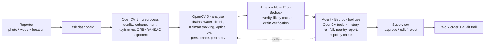

# DrainWatch AI

**Turning ordinary street footage into prioritised, evidence-backed drainage work.**
OpenCV 5 measures what the camera sees, Amazon Nova Pro (Amazon Bedrock) checks it, an agent decides what
should happen next, and a supervisor approves it.

Built for the **OpenCV AI Competition 2026, powered by AWS**.

> 🎬 **Demo video:** _add your YouTube link here_

---

## The problem
Blocked drains and standing water are early signs of urban flooding, but they are usually found too late,
after the street has flooded. Crews cannot inspect every drain often, citizen reports are vague and hard to
prioritise, and standing water can have different causes that each need a different team (a blocked drain
needs cleaning, a dip in the road needs repair, an overloaded system needs engineering).

## What DrainWatch does
1. **Report:** anyone uploads a photo set or a short video of a drain, with location and a note.
2. **Preprocess (OpenCV 5):** frames are sampled, quality-scored, enhanced only where needed, de-duplicated
   into keyframes and aligned to each other.
3. **Analyse (OpenCV 5):** drains, water and debris are detected; drains are tracked across frames; moving
   objects are ignored; persistence over time and the water's position relative to the drain are measured.
4. **Severity check (Amazon Nova Pro):** the model rates severity and the likely cause from the photos and
   OpenCV's measurements, verifies each detected drain from a close-up, and DrainWatch cross-checks the two.
5. **Recommend (agent on Amazon Bedrock):** an agent investigates with tools (OpenCV re-analysis, drain
   close-up, comparison with the previous visit, site history, nearby reports, rainfall) and submits a
   priority, action and crew. A policy check enforces the investigation and priority rules.
6. **Decide (human in the loop):** a supervisor approves, edits, asks for better footage or rejects. Approval
   creates a work order with a due date. Every step is recorded in an audit trail.

## Architecture



| Layer | Technology | Where |
|---|---|---|
| Dashboard and storage | Flask 3, Jinja, file-based JSON storage | `app/inspections/` |
| Preprocessing | OpenCV 5 | `app/vision/preprocess.py`, `quality.py`, `frames.py`, `registration.py` |
| Analysis | OpenCV 5 | `app/vision/analysis.py`, `detection.py`, `tracking.py`, `temporal.py`, `geometry.py`, `evidence.py` |
| Severity check | Amazon Nova Pro via Bedrock Converse API | `app/ai/severity.py`, `bedrock.py` |
| Agent | Amazon Nova Pro tool use (Bedrock Converse) | `app/ai/agent.py`, `tools.py`, `explain.py` |
| Human review | Flask | `app/inspections/review.py`, `app/work_orders.py` |

## How OpenCV 5 is used
OpenCV does the measuring; the AI models interpret and check its output and never create detections.

| Stage | OpenCV 5 techniques | Output |
|---|---|---|
| Frame sampling | `VideoCapture`, `grab`/`retrieve` sampling (~3 fps), EXIF-aware `imread` | sampled frames |
| Quality scoring | Laplacian variance on a contrast-stretched image (sharpness), Immerkær noise estimate on flat pixels (`filter2D`, `Sobel`), brightness and contrast | per-frame quality and issues |
| Adaptive enhancement | gamma `LUT`, `createCLAHE` in LAB, `fastNlMeansDenoisingColored`, unsharp mask | enhanced frames, applied only where an issue was measured |
| Keyframes | HSV histograms with `calcHist` and `compareHist` | keyframes |
| Registration | `ORB_create`, `BFMatcher`, `estimateAffinePartial2D` (RANSAC), `warpAffine` | every frame aligned to a reference; camera motion |
| Drain detection | dark-slot contours (`findContours`, `minAreaRect`, `approxPolyDP`) grouped into grates; gradient-orientation histograms (`Sobel`, `cartToPolar`) for bar patterns | drain boxes |
| Water and debris | HSV cues relative to the road's own brightness, relative local texture, Canny edge density, morphology, `connectedComponentsWithStats` | water and debris masks |
| Tracking | `KalmanFilter` (constant velocity) on registered detections | stable drain IDs across frames |
| Motion | `calcOpticalFlowFarneback` on registered frames | passing cars and people are not counted as debris |
| Persistence | masks accumulated in reference coordinates | water and debris present in most frames versus transient reflections |
| Drain condition and geometry | `distanceTransform`, edge bands with `dilate`, component centroids | how much of the grate is covered, wet edge, debris and water around it, and the cause hint (blockage versus surface depression) |
| Evidence and privacy | overlays, `applyColorMap` heatmap, timeline chart, Haar `CascadeClassifier` face and plate blurring | annotated evidence images |
| Agent tools | re-enhance and re-analyse a frame, drain close-up with slot visibility, registration against the previous visit with a change map | images and measurements that change the agent's decision |

## How AWS is used
- **Amazon Bedrock, Converse API, `amazon.nova-pro-v1:0`, us-east-1.**
  - The **severity check** sends the clean photo, OpenCV's annotated evidence, a close-up of each detected
    drain and OpenCV's measurements, and receives structured JSON (severity, likely cause, crew, drain
    verification and corrections to OpenCV).
  - The **agent** uses Bedrock **tool use** in a multi-step loop.
- AWS is used for the models only; the app runs locally.

## The agentic loop (perception → decision → action)
The agent can call 7 tools: three OpenCV tools, three information tools and `submit_recommendation`.
Two guardrails make sure vision results actually shape each decision:
- **Investigation policy.** `submit_recommendation` refuses until the required checks have been done: a
  drain close-up when a real drain is present, a comparison when the site has history, and a frame
  re-analysis when quality issues or cross-check problems exist.
- **Priority policy.** DrainWatch computes the expected priority itself: severity sets the base level,
  which is raised one step for recurrence, for heavy rain forecast, or for worsening since the last visit.
  The agent must follow it or give an `override_reason`, which the supervisor sees.

The page shows the agent's steps in plain language for non-technical supervisors; the raw tool trace is
available under "Technical details".

## Run it

### Requirements
- Python 3.10+
- An AWS account with **Amazon Bedrock model access to Amazon Nova Pro** in `us-east-1`, and credentials
  (AWS CLI profile or access keys) allowed to call `bedrock:InvokeModel` / Converse.

### Setup
```powershell
git clone https://github.com/Alagapie/DrainWatch-AI.git
cd DrainWatch-AI
python -m venv .venv
.venv\Scripts\activate            # macOS/Linux: source .venv/bin/activate
pip install -r requirements.txt
copy .env.example .env            # macOS/Linux: cp .env.example .env
```
Edit `.env`: set `AWS_PROFILE` (or the access keys), keep `AWS_REGION=us-east-1` and
`BEDROCK_MODEL_ID=amazon.nova-pro-v1:0`, and set a random `SECRET_KEY`.

### Start
```powershell
python run.py
```
Open http://127.0.0.1:5000, upload a photo or a short video of a drain, and watch the pipeline run.
Results and evidence are stored under `data/inspections/<id>/`.

### Reproduce the demo video
```powershell
pip install playwright imageio-ffmpeg
python -m playwright install ffmpeg
python demo/make_clip.py demo/assets/puddle_grate.jpg demo/assets/d14_followup.mp4
# start the app, upload puddle_grate.jpg and then d14_followup.mp4 for site D-14, then:
python demo/record_demo.py http://127.0.0.1:5000 <follow-up-inspection-id> demo/out
```

## Project structure
```
app/
  __init__.py, config.py, filters.py, work_orders.py
  inspections/   routes, storage (inspection.json + audit.jsonl), pipeline (background stages), review (M6)
  vision/        OpenCV 5: quality, frames, registration, preprocess, detection, tracking,
                 temporal, geometry, evidence, analysis
  ai/            Bedrock: bedrock (client), severity (Nova Pro check), agent, tools, explain
  templates/, static/
demo/            demo clip generator, video recorder, title cards, demo photos
submission/      voice-over script and Devpost text
```

## Evaluation (what we tested)
Testing was done on a small set of real photos and generated test footage, not a large labelled dataset:
- **Upload and validation:** bad files, mixed media, bad coordinates and missing fields are rejected.
- **End-to-end runs** on single photos, mixed unrelated photos, a dark and noisy synthetic video, a
  handheld follow-up video and a broken file. Every stage completes or fails with a clear message and a
  retry button. 88 evidence and page links were checked, with none broken.
- **Real Wikimedia photos** (credited below):
  - Grates are detected as one drain.
  - A puddle in a road dip is classified as a **surface depression → road repair**.
  - A leaf-covered grate is classified as a **drain blockage → drain cleaning**.
  - A flooded car park is rated **critical → engineering review**; in that photo OpenCV under-measured
    the water and boxed a car as a drain, and both errors were caught by the severity check.
- **Agent:** the investigation and priority policies were exercised. The agent was refused when it tried to
  skip the OpenCV checks, raised the priority for recurring sites, and was corrected when its priority
  contradicted the evidence.

## Limitations
- OpenCV's rules are classical and hand-tuned. They under-measure rippled or muddy floodwater, can mistake
  dark gaps or shadows for water, and can box non-drains in busy scenes. The severity check catches these
  cases in testing, but the system has **not been validated on a large labelled dataset**; the metrics
  planned in the project document (precision/recall, IoU, false-alert rate) are future work.
- Persistence over time needs a video or several photos of the same spot; single photos are marked
  "persistence unknown".
- The vision model and agent can vary between runs; the policy check and the human review limit the impact.
- Storage is local JSON files; there is no authentication or deployment, and it is not ready for production.

## Responsible use
DrainWatch is decision support, not an autonomous system:
- A supervisor approves every action.
- Model confidence and disagreements are shown, not hidden.
- OpenCV's raw measurements stay visible.
- Faces and licence plates are blurred in evidence images where detected.
- No individual tracking or biometric identification is performed.
- Every step is logged in an audit trail.

## Credits
Demo photos are from Wikimedia Commons and are used under their licences. The demo clip
`demo/assets/d14_followup.mp4` is derived from the first photo and is shared under the same licence.
- *A puddle after rain on a damaged asphalt surface, a storm drain grate on*: Tarasna0922,
  [CC BY-SA 4.0](https://commons.wikimedia.org/wiki/File:A_puddle_after_rain_on_a_damaged_asphalt_surface,_a_storm_drain_grate_on.jpg)
- *2005-06-07 Car died in puddle*: Ildar Sagdejev (Specious),
  [CC BY-SA 3.0](https://commons.wikimedia.org/wiki/File:2005-06-07_Car_died_in_puddle.jpg)
- *Gullydeckel in Hemel Hempstead*: Oxfordian Kissuth,
  [CC BY 3.0](https://commons.wikimedia.org/wiki/File:Gullydeckel_in_Hemel_Hempstead.jpg)

Weather data: [Open-Meteo](https://open-meteo.com/). Maps: © OpenStreetMap contributors.
